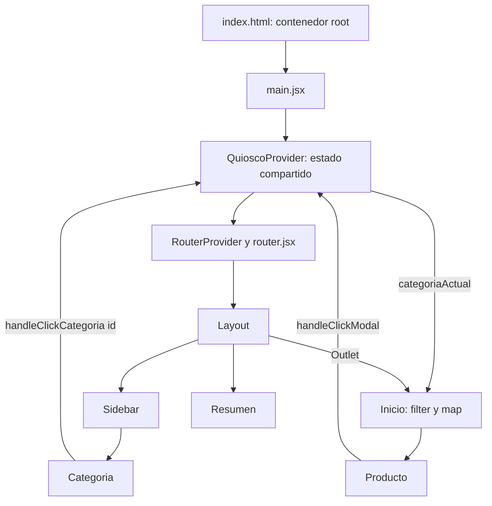

# Guía de estudio del proyecto Quiosco

Esta documentación describe el código revisado el 23 de septiembre de 2026. Es una fotografía del proyecto: los números de línea pueden cambiar cuando edites los archivos.

## Cómo leerla

1. [Conceptos y glosario](./conceptos.md): JavaScript, React, props, estado, hooks, efectos, contexto, consultas y modal.
2. [Frontend explicado línea por línea](./frontend-linea-por-linea.md): código real y explicación de cada línea de los componentes, vistas, datos y configuración.
3. [Carpetas, archivos y backend](./estructura-y-backend.md): función de las carpetas, Laravel y archivos de soporte.
4. [Cambios, errores y funcionamiento](./cambios-y-flujos.md): lo que trabajamos y cómo se conecta.

## Qué hace actualmente

El frontend muestra un catálogo de 59 productos organizado en seis categorías. Al seleccionar una categoría, actualiza el título, filtra los productos y resalta la categoría seleccionada. El botón «Agregar» cambia un estado booleano llamado `modal`.

El catálogo proviene de archivos JavaScript locales. No se encontró una petición HTTP para obtenerlo desde Laravel en las vistas revisadas. Los formularios de acceso y registro son interfaces todavía sin integración de autenticación. `Resumen.jsx` muestra únicamente el texto «Resumen».

`react-modal` aparece en las dependencias, pero el `Layout.jsx` revisado no renderiza una ventana modal: solo lee e imprime el estado. Tener la biblioteca instalada no equivale a tener la ventana implementada.

## Mapa de funcionamiento

## Alcance

Las explicaciones de líneas cubren el frontend escrito para la aplicación y su configuración. Para Laravel se explica la estructura, las instrucciones y los bloques de sus archivos base. Las dependencias de terceros (`node_modules`, `vendor`), archivos de bloqueo, imágenes y CSS generado se describen por su función; no se reproduce cada línea generada. No se copiaron credenciales ni archivos `.env`.

Esta documentación no modifica el comportamiento de la aplicación.
